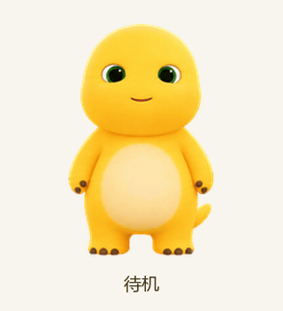

# 奶龙 · ChatGPT 工作宠物

一只陪你做研究的奶龙。等你回应时，它会摊开小爪子，遇到难题时会抱臂托腮。开心时先轻轻一跳，落地后双手捂住肚子，闭着眼睛笑弯腰。



[下载宠物精灵图 PNG](https://github.com/zhhpan/nailong-pet/releases/latest/download/nailong.png) · [单看捧腹大笑](assets/laugh.gif) · [完整 MP4 预览](assets/nailong.mp4) · [查看动画原画](source/)

## 在 ChatGPT 中使用

1. 下载上面的 PNG 原文件，也可以从仓库的 `assets/nailong.png` 获取。
2. 在已启用 Pets 的 ChatGPT 工作模式中附上这张 PNG，发送「请校验这张 Work Pets v2 精灵图，用它创建一个叫『奶龙』的宠物，并设为当前宠物。」

请上传透明 PNG 原图。上方的 GIF 带有动作名称和背景色，供预览使用。

## 捧腹大笑与帧率

工作模式会在原有的跳跃动作中播放「起跳 → 落地捂肚 → 弯腰大笑 → 直起身」这段五帧动画。已经有奶龙的用户可以附上新版 PNG，请 Pets 更新现有奶龙的精灵图。

独立的捧腹大笑动画使用全部八张原画。GIF 和 MP4 预览在相邻姿势之间补入中间帧，以 **25 fps** 播放。大笑一个循环有 39 帧，时长 1.56 秒，也可以下载透明 WebP 叠在自己的画面上。工作模式使用自己的播放节奏，当前 Pets 更新接口没有自定义帧率参数。[下载透明动图](https://github.com/zhhpan/nailong-pet/releases/latest/download/laugh.webp) · [观看大笑视频](assets/laugh.mp4)

## 修改某一帧

在仓库根目录运行以下命令，安装 Pillow 并拆出各个动作的透明帧。

```sh
python -m pip install -r requirements.txt
python tools/frames.py split assets/nailong.png build/frames
```

例如，要修改托腮的动作，编辑 `build/frames/running/` 中的 PNG。每格保持 **192 × 208 像素**，保留透明背景，把改好的帧重新拼成一张图。

```sh
python tools/frames.py pack build/frames build/nailong-edited.png
```

两个命令都需要新的输出路径。保持各帧原样拆出、再拼回时，整张图的 RGBA 像素与原图一致。

### 重新导出 25 fps 预览

先安装 FFmpeg，使终端能运行 `ffmpeg`。以下命令会为每个动作生成 GIF 和 MP4，同时将独立大笑动画导出为透明 WebP。需要改动捧腹大笑的姿势时，可以编辑 `source/laugh-keys.png` 中对应的透明帧。

```sh
python -m pip install -r requirements-preview.txt
python tools/preview.py assets/nailong.png build/preview --laugh-strip source/laugh-keys.png
```

## 动画布局

精灵图共 8 列、11 行，大小为 **1536 × 2288 像素**。前九行依次是待机、向右跑、向左跑、挥手、跳跃、沮丧、等待回应、抱臂思考和检查结果，共 57 帧。最后两行是 16 个注视方向，从正上方开始，每格顺时针转 22.5°。另外 15 格完全透明。

如果想从原画调整动作幅度或重新取景，`source/` 中有用 ImageGen 制作的全身定稿、动作条和四向注视参考，均以无损 WebP 保存。[原画文件与帧序说明](source/README.md)

## 许可

这是非官方奶龙同人作品。仓库中的脚本、文档及贡献者有权授权的原创动画制作部分采用 MIT 许可证。奶龙角色形象及相关标识的权利归各自权利人所有。[许可证全文](LICENSE)
